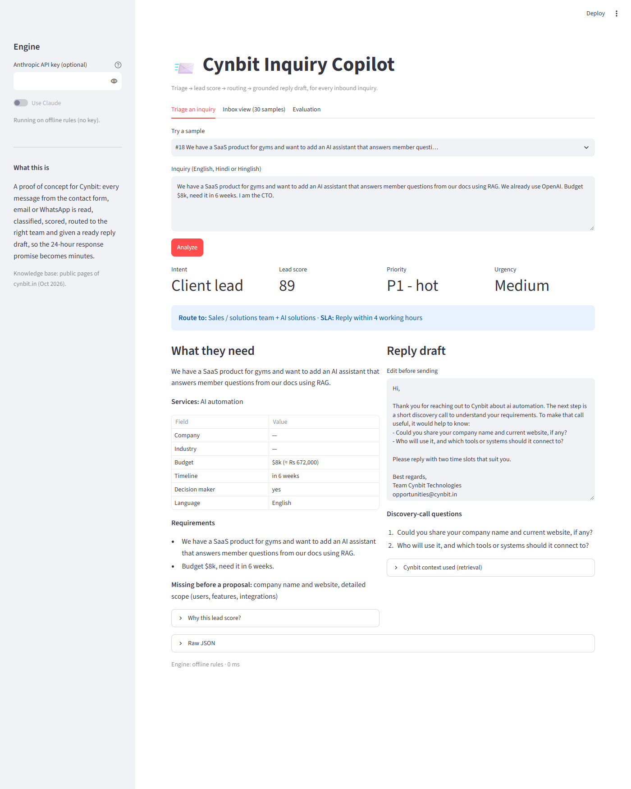
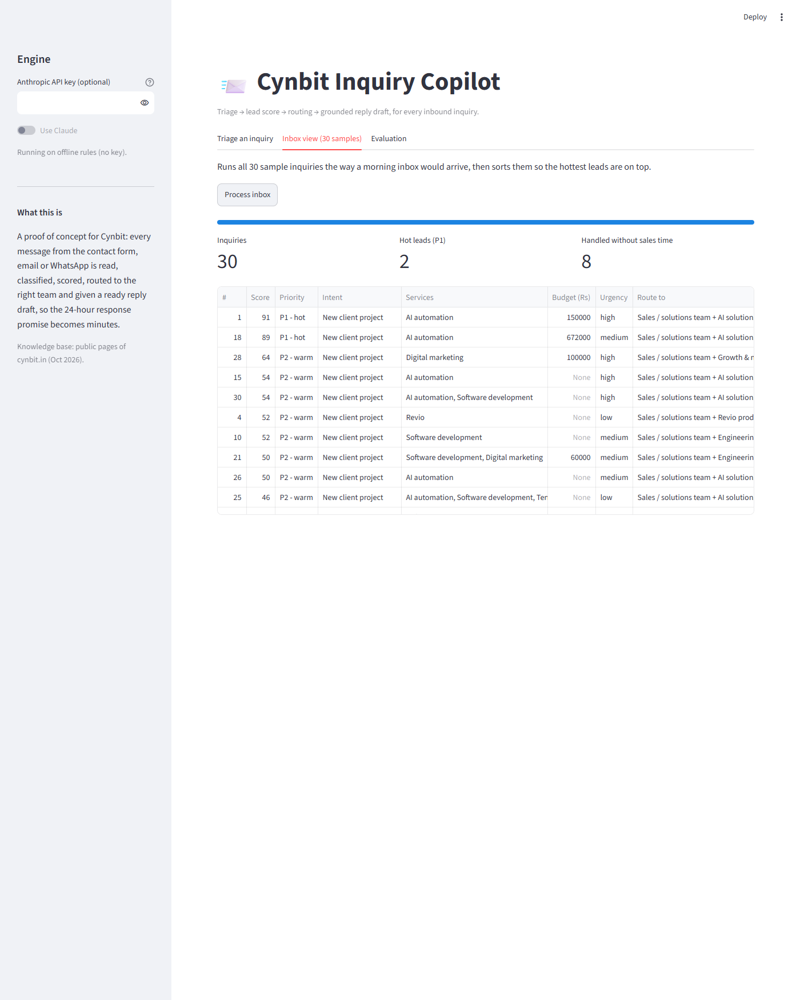

# Cynbit Inquiry Copilot

**AI/ML Engineer Intern assessment: "Identify an AI opportunity for Cynbit"**, by Divya Lalwani.

Every message that reaches Cynbit (website form, email, WhatsApp; English, Hindi or Hinglish) is read and:

- classified (client lead, internship, job, partnership, support, spam)
- scored as a lead, with the reasons shown
- routed to the right team, with a response-time target
- answered with a reply draft that only cites real Cynbit services and case studies

A person approves each reply before it is sent. The 24-hour response promise becomes minutes, and sales only sees real leads.



## Deliverables

| # | Deliverable | Where |
|---|---|---|
| 1 | **AI Opportunity Report**: Cynbit analysis, 10 AI/ML opportunities scored, why this one first, business case, risks, roadmap | [docs/01_AI_Opportunity_Report.md](docs/01_AI_Opportunity_Report.md) |
| 2 | **AI/ML Proof of Concept**: Streamlit app + FastAPI service + CLI, with evaluation and tests | this repository ([run it](#run-it)) |
| 3 | **Technical Approach Report**: model choices, data pipeline, prompt design, architecture, evaluation, execution plan | [docs/02_Technical_Approach.md](docs/02_Technical_Approach.md) |

## How it works

```
inquiry ─► BM25 retrieval over Cynbit's services / products / case studies
        ─► Claude (structured JSON output, grounded prompt)   ── on any error ──►  offline rules
        ─► lead score 0-100 with reasons (plain code) ─► priority P1/P2/P3 ─► team + response target
        ─► reply draft + discovery-call questions ─► human approves and sends
```

- **Runs without an API key.** With no key, the offline rule engine is used. Add an Anthropic key in the sidebar (kept only for that browser session) or as `ANTHROPIC_API_KEY` to switch to Claude.
- **Model:** `claude-opus-5-5` at `effort=low`. Both can be changed with the `CYNBIT_MODEL` / `CYNBIT_EFFORT` environment variables.

## Run it

```bash
python -m venv .venv
.venv\Scripts\activate            # macOS/Linux: source .venv/bin/activate
pip install -r requirements.txt

streamlit run app.py              # demo UI → http://localhost:8501   (?sample=18 opens sample 18 analysed)
uvicorn api:app --reload          # REST API → http://localhost:8000/docs   POST /triage {"text": "..."}
python triage.py "Need a WhatsApp bot for my clinic, budget 1.5 lakh, in 3 weeks"
python evaluate.py                # metrics on the 30 labelled inquiries (add --llm for Claude)
python -m unittest discover tests
```

Optional: `set ANTHROPIC_API_KEY=...` (Windows) or `export ANTHROPIC_API_KEY=...` before running, to use Claude.

## Results (offline rules baseline, 30 labelled inquiries)

| Intent accuracy | Service-line F1 | Urgency | Budget | Spam F1 |
|---|---|---|---|---|
| 0.90 | 0.846 | 1.00 | 1.00 | 1.00 |

The rules break exactly where meaning matters. For example, a Rs 4 lakh AI invoice-automation lead was routed to *support* because it contains the word "invoice". Those cases are why the LLM is used. The full analysis is in the [Technical Approach](docs/02_Technical_Approach.md#6-evaluation).



## Project layout

```
app.py                  Streamlit demo (triage, inbox, evaluation tabs)
api.py                  FastAPI service
triage.py               command line
evaluate.py             metrics + mistakes on data/eval_inquiries.jsonl
copilot/
  pipeline.py           retrieve → analyze → score → route
  llm.py                Claude analyzer (structured outputs, grounding, caching, fallback)
  offline.py            rule-based analyzer (baseline + fallback)
  retrieval.py          BM25 over the knowledge base
  schema.py             output JSON schema
data/
  cynbit_kb.json        knowledge base from cynbit.in public pages
  eval_inquiries.jsonl  30 hand-labelled test inquiries
docs/                   the two reports + screenshots
tests/                  unit tests (Claude path mocked)
```

*All Cynbit information comes from its public website (October 2026). The sample inquiries are made up for testing.*
