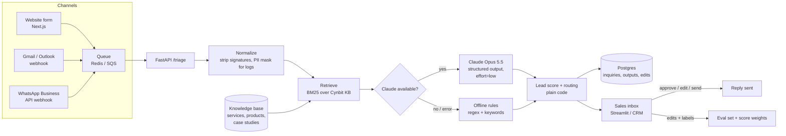

# Technical Approach: Cynbit Inquiry Copilot

This document covers the model choices, the data pipeline, the prompt design and architecture, the evaluation, and the execution plan for the proof of concept in this repository.

---

## 1. Problem framing

**Input:** one free-text message (website form, email or WhatsApp), in English, Hindi or Hinglish, plus the sender's channel.

**Output:** one JSON record that downstream systems (CRM, inbox, dashboard) can trust:

| Field | Type | Used for |
|---|---|---|
| `intent` | one of 6 classes | routing; whether sales sees it at all |
| `service_lines` | multi-label from 7 values | which team / product owner |
| `company`, `industry`, `requirements[]`, `summary` | text | CRM record, call prep |
| `budget_inr`, `budget_text`, `timeline`, `urgency`, `decision_maker` | numbers / enums | lead score |
| `missing_info[]`, `discovery_questions[]` | text | the reply and the discovery call |
| `language` | english / hindi / hinglish | reply language |
| `reply_draft` | text | sent after a person approves it |

**Two ML tasks sit inside this:**

1. **Information extraction plus classification** (multi-class intent, multi-label services, slot filling).
2. **Grounded generation** (the reply).

**Lead scoring and routing are kept as plain code on purpose:**

- they must be explainable to salespeople ("why is this 89?")
- they are cheap to change
- their weights should come from Cynbit's won/lost deals once that data exists, not from an LLM's opinion

---

## 2. Architecture

**What is in this repository:**

| File | Role |
|---|---|
| [`copilot/retrieval.py`](../copilot/retrieval.py) | BM25 search over [`data/cynbit_kb.json`](../data/cynbit_kb.json) |
| [`copilot/llm.py`](../copilot/llm.py) | Claude analyzer: structured outputs, grounding prompt, prompt caching, refusal fallback |
| [`copilot/offline.py`](../copilot/offline.py) | Rule-based analyzer: the baseline and the fallback |
| [`copilot/pipeline.py`](../copilot/pipeline.py) | Orchestration, lead score, priority, routing, response time target, latency |
| [`app.py`](../app.py) | Streamlit demo (single triage, inbox view, evaluation tab) |
| [`api.py`](../api.py) | FastAPI service (`POST /triage`) for the form, email and WhatsApp hooks |
| [`evaluate.py`](../evaluate.py) | Metrics on the labelled set |
| [`tests/`](../tests) | Unit tests, including a mocked Claude path and the fallback when the API fails |

---

## 3. Data pipeline

### 3.1 Knowledge base (what the copilot is allowed to talk about)

- **Source:** Cynbit's public pages (services, products, case studies, BitElevate), turned into 29 short documents. Each document has `type`, `service_line`, `industry`, `title` and `text`.
- **Why a curated JSON file and not a site crawl:** replies must only quote approved facts. A small reviewed file is safer than scraping marketing copy, and anyone in sales can edit it.
- **In production:** the knowledge base lives in Postgres or Supabase. Edits go through an approval step. It is re-indexed on change.

### 3.2 Retrieval

- **Now:** BM25 (written from scratch; no dependencies) with title boosting. With about 30 short documents, BM25 is accurate, explainable (term matches) and costs nothing.
- **Later:** hybrid search. BM25 is combined with multilingual embeddings in pgvector or Pinecone (both already in Cynbit's stack), using reciprocal rank fusion. This matters once the knowledge base holds hundreds of past proposals (opportunity A2) and once more Hinglish synonyms appear ("dukaan" = shop).
- **Use in the prompt:** the top 5 documents are put into the prompt as `CONTEXT`. They are also shown in the UI, so a salesperson can see what the reply was based on.

### 3.3 Inquiry data and labels

- **Today:** there is no labelled history, which is the classic cold-start problem. The PoC therefore uses zero-shot LLM extraction plus a **hand-labelled evaluation set of 30 realistic inquiries**: 18 client projects, 3 support, 3 spam, 2 internship, 2 job, 2 partnership. Four are in Hinglish.
- **Pilot:** every inquiry, model output and salesperson edit is stored. Edits are free labels:
  - a changed intent or service is a correction
  - a reply sent unchanged is a positive signal
- **After about 500 labelled inquiries:**
  - the evaluation set grows into a held-out test set
  - the lead-score weights are re-fitted with logistic regression on whether a discovery call happened and whether the deal was won
  - a small fine-tuned or distilled classifier becomes possible, if cost or latency ever matter

### 3.4 Privacy (DPDP Act 2023)

- Store only what is needed for sales follow-up. Mask phone numbers and emails in logs and analytics.
- Retention limit for spam and declined inquiries (for example 90 days).
- API traffic over TLS; the provider is configured for no training on inputs; secrets in environment variables or Streamlit secrets, never in the repository (the `.gitignore` excludes them).

---

## 4. Model choices

| Option | Strengths | Weaknesses | Verdict |
|---|---|---|---|
| Regex and keyword rules | Free, instant, explainable, works offline | Brittle on paraphrase and Hinglish; cannot write replies | **Kept as baseline and fallback** |
| TF-IDF + logistic regression / fine-tuned small BERT | Cheap and fast at inference | Needs hundreds of labelled inquiries Cynbit doesn't have yet; extraction and reply still need another model | Revisit after the pilot produces labels |
| Self-hosted open model (Llama / Qwen via Ollama) | Data stays in-house, no per-call cost | GPU hosting and ops; weaker Hinglish understanding and JSON reliability at small sizes | Possible later for privacy-sensitive clients |
| **Hosted frontier LLM (Claude) with structured outputs** | Zero-shot, strong multilingual understanding, schema-guaranteed JSON, one call does extraction + reply | Per-call cost, network dependency | **Chosen for the PoC** |

### Why Claude, and how it is configured

- **Model:** `claude-opus-5-5`. Set with the `CYNBIT_MODEL` environment variable, so a cheaper model (for example `claude-haiku-5-5`) can be compared on the same evaluation set before going to high volume.
- **Effort:** `low` (`CYNBIT_EFFORT`). Triage is a short, well-specified task, and low effort keeps latency and token cost down. If evaluation shows errors on long or ambiguous inquiries, effort can be raised for those cases only.
- **Structured outputs:** `output_config.format` with a JSON schema ([`copilot/schema.py`](../copilot/schema.py)). The answer is always parseable and always has every field, with enums for intent, service lines, urgency and language. There is no "please reply in JSON" prompt hacking and no retry-on-parse-error loop.
- **One call per inquiry** (extraction + reply together). The reply can then use the extracted gaps directly, and latency stays at a single round trip.
- **Prompt caching:** the system prompt is marked `cache_control: ephemeral`, so repeated calls reuse the cached instructions. That is cheaper and faster at inbox volume.
- **Refusal fallback:** the server-side `fallbacks: "default"` option is enabled, so if the model declines, the API retries on a fallback model within the same call. Any remaining API error (outage, rate limit, refusal) is caught in `pipeline.run`, and the offline rules answer instead. **An inquiry is never lost**; this path is covered by a unit test.

---

## 5. Prompt engineering

The full prompt is in [`copilot/llm.py`](../copilot/llm.py). The design choices:

1. **A role with a narrow job.** "Inquiry desk analyst for Cynbit Technologies". The model knows where the message came from and who will read the output.
2. **Field-by-field definitions with decision rules, not vague wishes.** For example:
   - "urgency: high if they need it within about 3 weeks or say urgent/ASAP, medium if within 3 months, else low"
   - "budget_inr … convert lakh, crore, k, and USD at 84"
   - "decision_maker: true only if they say they are a founder, owner, director…"

   The same rules are implemented in the offline analyzer, so the two engines can be compared field by field.
3. **Grounding rules for the reply.** Mention at most one case study or product **from CONTEXT**. Never quote prices or delivery dates. Never mention a client, product or result that isn't in CONTEXT.
4. **The sender's language.** Reply in English, Hindi or Hinglish to match the sender. This is important in Jaipur; 4 of the 30 test inquiries are Hinglish.
5. **Prompt-injection hygiene.**
   - The inquiry is placed between `<<<` and `>>>` delimiters, after the context.
   - The instructions live in the system prompt.
   - The output is restricted by the schema.
   - The model has no tools, so injected text can at worst change a draft, and a person reviews every draft.
6. **Explicit "unknown" values** (`""`, `[]`, `0`) with "Do not guess company names". This prevents confident made-up fields, which would pollute the CRM.
7. **Stable prefix for caching.** The system prompt has no timestamps or per-request values; everything that changes goes in the user message.

---

## 6. Evaluation

### Test set

[`data/eval_inquiries.jsonl`](../data/eval_inquiries.jsonl): 30 hand-labelled inquiries.

- **Variety:** all 6 intents, 7 service lines, budgets in Rs / lakh / hazaar / USD and ranges ("3–5 lakh"), Hinglish, a one-line "hi i want website", and spam.
- **Labels:** intent, service lines, urgency and budget.

### Metrics

[`evaluate.py`](../evaluate.py) reports:

- intent accuracy and macro-F1
- service-line micro-F1, for client and support inquiries
- urgency and budget accuracy on client leads (budget counts as correct within ±10%)
- spam F1
- median latency

### Results: offline rules (measured, `python evaluate.py`)

| Metric | Offline rules |
|---|---|
| Intent accuracy | **0.90** |
| Intent macro-F1 | 0.91 |
| Service-line micro-F1 | **0.846** |
| Urgency accuracy (leads) | 1.00 |
| Budget accuracy (leads) | 1.00 |
| Spam F1 | 1.00 |
| Median latency | < 1 ms |

**Read these numbers with care.** I wrote the rules and the test set together, so the baseline is optimistic. It is an upper bound for rules, not an estimate of real-world accuracy.

Even so, the mistakes it makes are the kind that cost money:

| Inquiry | What the rules did | Why |
|---|---|---|
| #9, a manufacturer asking for AI invoice processing (Rs 4 lakh lead) | Sent to **support** | The word "invoice" matched the support keywords |
| #22, an e-commerce brand wanting an AI support agent (3–5 lakh) | Sent to **support** | "support" and "tickets" matched |
| #13, a university placement officer, a natural **Cynbit Studio** buyer | Labelled a **job seeker** | "Placement… Officer… position" matched job keywords |
| #5, #11, #25 | Extra services added | Keywords like "app" or "software" over-triggered |

**These are exactly the meaning-dependent cases an LLM handles well**, and they are the reason for the LLM design.

### Claude run

`ANTHROPIC_API_KEY=... python evaluate.py --llm` writes `results/eval_llm.json`, and the Streamlit Evaluation tab shows both engines side by side. *An API key was not available while this PoC was built, so the Claude numbers are not reported here.* The Claude code path is covered by mocked unit tests (request shape, schema, parsing, fallback). Running the command is the first step of the pilot.

### Reply quality (planned, not automated in the PoC)

A rubric of 5 checks, each pass/fail:

1. Uses only CONTEXT facts.
2. No price or date promises.
3. Right language.
4. Asks the missing-info questions.
5. Under 150 words, professional tone.

The rubric is scored by an LLM judge on every draft and by a human on a 10% sample. In production, the share of drafts sent unchanged or lightly edited is the most useful single measure of reply quality.

**Acceptance bar for going live:**

- intent ≥ 0.95
- service-line F1 ≥ 0.90
- zero grounding violations on the human-reviewed sample

---

## 7. Deployment and operations

| Concern | PoC | Production |
|---|---|---|
| UI | Streamlit (`app.py`); deployable free on Streamlit Community Cloud | Inbox inside Cynbit's CRM or a small Next.js admin page |
| API | FastAPI (`api.py`, `POST /triage`) | Same service in a container on AWS ECS / Azure Container Apps, behind Cynbit's API gateway |
| Ingestion | Paste / sample data | Website form posts to the API; Gmail push notifications; WhatsApp Business webhook; Redis/SQS queue for bursts and retries |
| Storage | `results/` JSON | Postgres: inquiries, model outputs, human edits, final status |
| Monitoring | Latency, engine and errors shown in the UI | Dashboards for p50/p95 latency, cost per inquiry (token usage is returned per call), fallback rate, intent mix over time, edit rate |
| Model changes | Environment variables `CYNBIT_MODEL` / `CYNBIT_EFFORT` | Every prompt or model change must pass `evaluate.py` on the growing test set before release (regression gate in CI) |

---

## 8. Execution plan

| Week | Work | Exit criterion |
|---|---|---|
| 0 (done) | PoC: schema, retrieval, Claude + rules analyzers, scoring, Streamlit, FastAPI, 30-item eval, tests | Demo runs without a key; tests pass |
| 1 | Run the Claude evaluation; compare Opus 5.5 at low effort with Haiku 5.5 on accuracy, cost and latency; fix prompt gaps | Intent ≥ 0.95 on the 30-item set |
| 2 | Connect the website form + one Gmail inbox in **shadow mode** (drafts saved, nothing sent); Postgres logging | 100 % of real inquiries processed, fallback rate < 2 % |
| 3 | Sales labels 200 real inquiries in the UI; extend the eval set; LLM-judge for replies | Labelled set ≥ 200 |
| 4–5 | Human-approved sending; CRM sync; WhatsApp Business API | Median first reply < 1 h for P1 leads |
| 6 | Review: time saved, edit rate, conversions; decide on scale-up and on opportunity A2 (proposal generator) | Go / no-go with data |

---

## 9. Limitations of this PoC

- The knowledge base contains only public website content, so case-study details are short headlines.
- The test set is small (30) and was written by the same person who wrote the rules. Real inquiries will be messier.
- The lead-score weights are informed guesses until they are fitted on Cynbit's won/lost deals.
- The Claude path is unit-tested with a mocked client; its accuracy on the test set still has to be measured with an API key.
- Hindi in Devanagari script is detected, but the offline rules don't understand it; that case depends on the LLM.
